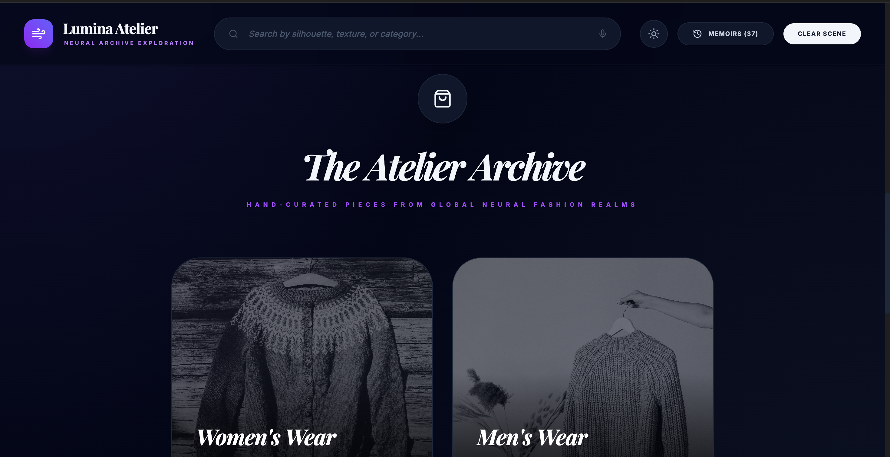
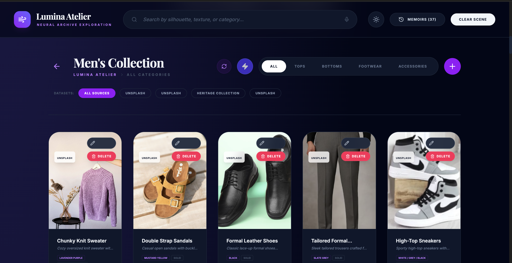
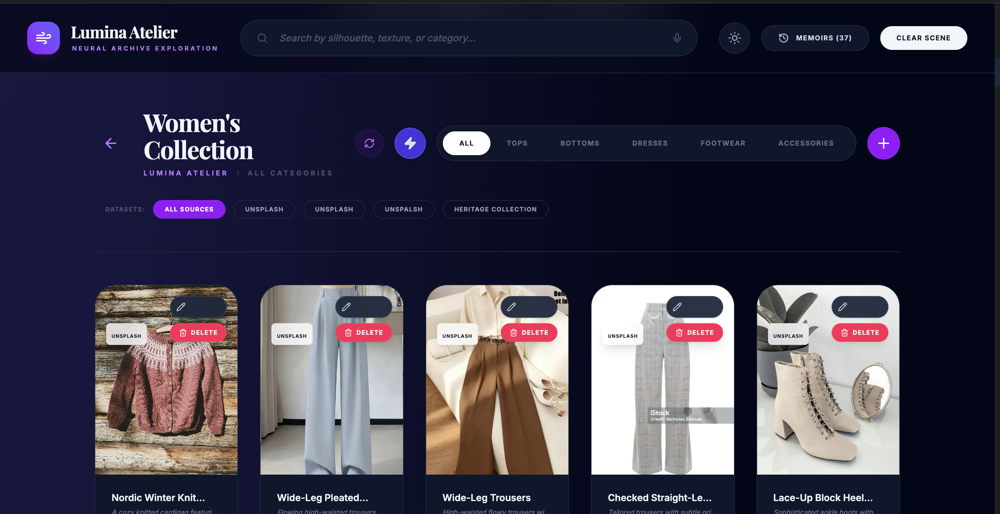
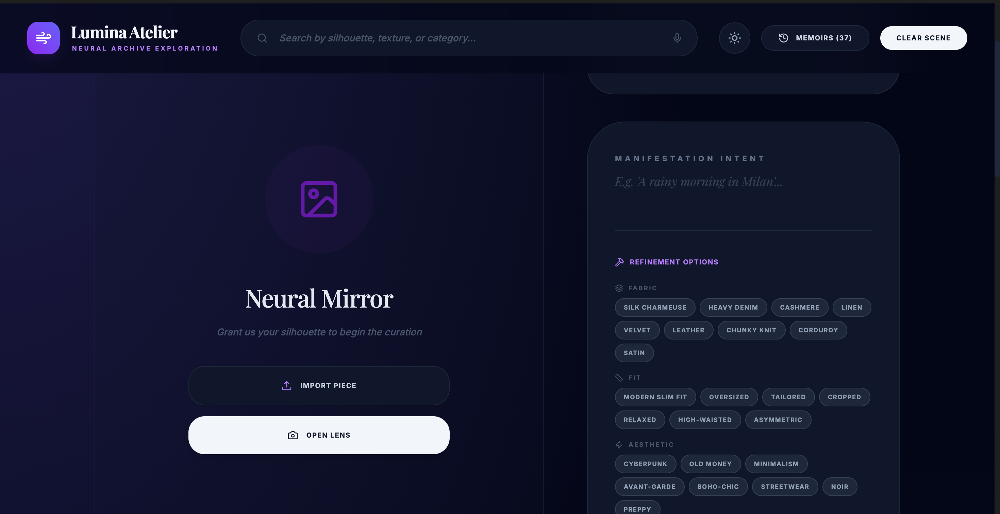
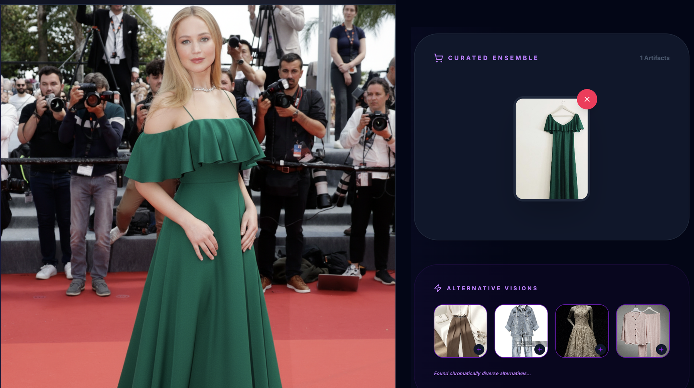
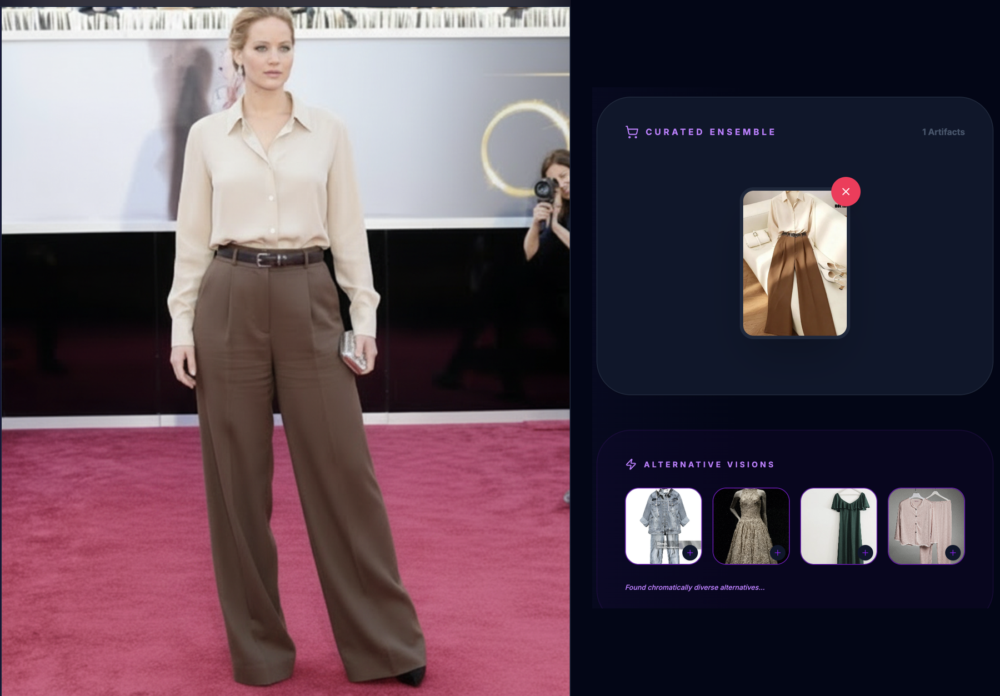

# 👗 Lumina Atelier: AI Virtual Wardrobe Stylist

An AI-powered virtual try-on app. Upload a photo or use your live camera, pick a top, pant, sunglasses or other accessory from a curated fashion archive, click **Invoke**, and the app generates an image of you wearing the selected outfit.

> 🤖 **Built with AI:** This project was built with the help of AI tools (Google AI Studio). The concept, research, system design, testing and documentation were done by our team.

🔗 **Live demo:** [Open the app in Google AI Studio](https://aistudio.google.com/apps/f4b142a0-42f2-45a4-9d43-a6abce9aa082?showPreview=true&showAssistant=true&fullscreenApplet=true)

📄 **Published research:** *"AI Integrated Virtual Wardrobe Stylist Using Vision-Based Body Analysis"*, presented at the **6th International Conference on Artificial Intelligence, 6G Communications and Network Technologies (ICA6NT 2026)**, Velammal Institute of Technology, Chennai, 25-26 March 2026. ([Certificate](certificate.png))

---

## 📸 Screenshots

| | |
|---|---|
| **The Atelier Archive** (Women's / Men's category selection) | **Men's Collection** (filter by tops, bottoms, footwear, accessories) |
|  |  |
| **Women's Collection** (includes dresses) | **Neural Mirror** (upload or live camera, with refinement options) |
|  |  | 
| **1-TryOn**  | **2-TryOn**  |
|  |  |


---

## 🎯 Problem Statement

Choosing an outfit that suits you is hard, and online shoppers can't see how a piece will look on them before buying. Existing smart-mirror and stylist systems often lack fashion focus, clothing analysis or real-time results. This project brings outfit recommendation and virtual try-on together in one easy-to-use app.

## ✨ Features

- **Two ways to input your photo:** upload an image (**Import Piece**) or use your live camera (**Open Lens**)
- **Curated fashion archive:** Women's Wear (121 pieces) and Men's Wear (91 pieces) organised into Tops, Bottoms, Dresses, Footwear and Accessories
- **Virtual try-on:** select a top, pant, sunglasses or other accessory, click **Invoke**, and see an image of yourself wearing it
- **Prompt-based styling (Manifestation Intent):** describe an occasion such as *"A rainy morning in Milan"*, a wedding, a party or a casual day
- **Refinement options:** fine-tune the look by **Fabric** (silk, denim, cashmere, linen, velvet, leather and more), **Fit** (slim, oversized, tailored, cropped and more) and **Aesthetic** (old money, minimalism, streetwear, boho-chic and more)
- **Curated Ensemble:** collect the selected pieces into one outfit
- **Memoirs:** history of past looks
- **Smart search:** search by silhouette, texture or category, with voice search
- **Manage the archive:** add, edit and delete pieces, and filter by dataset source
- **Light and dark theme**

## 🔄 How It Works

```
Capture / Upload Image
        ↓
Image Preprocessing      → resize, background removal, noise reduction
        ↓
Feature Extraction       → body shape detection, colour analysis, texture identification
        ↓
Outfit Recommendation    → match features with the database, generate suitable outfit suggestions
        ↓
Virtual Try-On & Display → overlay the outfit on the user image and show the final output
```

## 🎯 Objectives

1. AI-based outfit suggestions using user-uploaded photos
2. Analysis of user body features and appearance using image processing
3. Outfit recommendations based on user prompts (wedding, party, casual)
4. Virtual try-on preview showing how the selected outfit looks
5. A personalised and intelligent styling experience

## 🛠️ Tech Stack

- **Built with:** Google AI Studio (AI-assisted development)
- **Image processing and vision-based body analysis** for feature extraction
- **Fashion data:** Unsplash images plus a Heritage Collection dataset

## 🚀 How to Use

1. Open the live demo link
2. Choose **Women's Wear** or **Men's Wear** in the Atelier Archive
3. Browse by category (Tops, Bottoms, Dresses, Footwear, Accessories) and pick your pieces
4. Go to the **Neural Mirror**, then upload your photo (**Import Piece**) or use the camera (**Open Lens**)
5. Optionally add a prompt and refinement options (fabric, fit, aesthetic)
6. Click **Invoke** to see yourself wearing the outfit

## 🔮 Future Scope

- Real-time body and outfit analysis
- E-commerce integration, so users can buy the pieces they try on
- Larger and more diverse clothing datasets

## 📚 Literature Review (Summary)

| Paper | Year | Approach | Gap we addressed |
|---|---|---|---|
| Dharpan: The AI Style Suggestion (G. S. Kumawat) | 2023 | AI + ML to detect features and recommend outfits | Needs better cloth classification and real-time results |
| AI Clothing Stylist (Harshitha R.) | 2022 | Raspberry Pi, OpenCV, voice and face detection | Lacks fashion focus and clothing analysis |
| Face Detection in AI Stylist (Ramesh R. & Banerjee) | 2021 | Raspberry Pi based | No link to fashion or cloth detection |
| Magic Mirror for Cross-Buying (N. M. Zwienenberg) | 2023 | AI in retail, buying behaviour study | More retail psychology, less technical detail |
| Smart Mirror for Brand Engagement (A. M. Hanif) | 2023 | UX case study in fashion stores | Not focused on detection algorithms |

## 👩‍💻 Team

Group A01, B.Tech ENTC, Shri Vithal Education & Research Institute's College of Engineering, Pandharpur (An Autonomous Institute)

- **Neha Somawanshi**
- **Trupti Holkar**
- **Samiksha Khatawkar**

**Guide:** Dr. Sandeep Kadam

## 🔗 Connect

**Neha Somawanshi** | [Portfolio](https://somawanshi24.github.io/) | [LinkedIn](https://www.linkedin.com/) | [GitHub](https://github.com/somawanshi24)

---

*This project was developed for academic purposes. Fashion images are sourced from Unsplash and other public sources and belong to their respective owners.*
